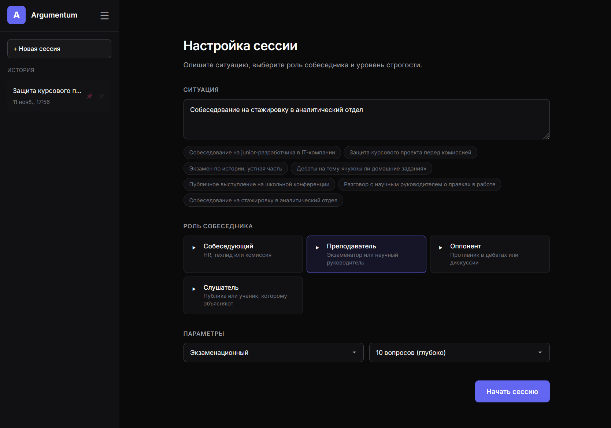
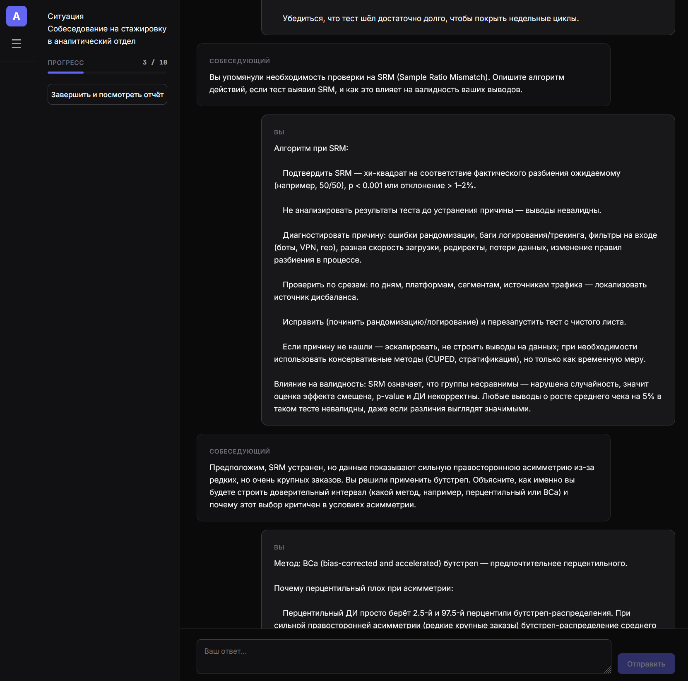

  <picture>
    <source media="(prefers-color-scheme: dark)" srcset="https://capsule-render.vercel.app/api?type=waving&color=0:0f0f0f,100:1a1a2e&height=200&section=header&text=Савелий&fontSize=70&fontColor=ffffff&animation=fadeIn&fontAlignY=35&width=100%" />
    <source media="(prefers-color-scheme: light)" srcset="https://capsule-render.vercel.app/api?type=waving&color=0:f8f9fa,100:e9ecef&height=200&section=header&text=Савелий&fontSize=70&fontColor=333333&animation=fadeIn&fontAlignY=35&width=100%" />
    
  </picture>

<h3 align="center">Начинающий Fullstack-разработчик (C# / ASP.NET Core, React)</h3>

  Имею практический опыт создания веб-приложений, проектирования баз данных и деплоя в облачные сервисы (Render, InfinityFree). 
  Активно использую AI-инструменты для ускорения разработки, интеграции API и автоматизации процессов. 
  Быстро обучаюсь, нацелен на написание чистого кода и доведение задач до работающего результата.

---

### Стек технологий

  <!-- КРАСИВЫЕ ЗАКРУГЛЕННЫЕ ИКОНКИ -->
  

---

### Флагманский проект: Argumentum

**Argumentum** — это интеллектуальный тренажёр для подготовки к собеседованиям, защитам проектов и экзаменам. Приложение использует нейросеть (GigaChat API), которая играет роль строгого HR-специалиста, преподавателя или оппонента, ведёт с пользователем диалог и оценивает его ответы по ходу сессии.

**Что реализовано:**
- Динамический промпт-инжиниринг: жесткий контроль количества вопросов и ролей.
- Безопасность: ключи API скрыты на серверном PHP-прокси.
- Деплой: настроен Docker-контейнер и автоматический деплой на облачную платформу Render.
- UX/UI: адаптивный интерфейс с темной темой, выезжающим меню на мобильных и фиксированным хедером.

 

**Стек проекта:** React, PHP, GigaChat API, Docker, Render.  
[Посмотреть репозиторий](https://github.com/TsSilllver/AiProject)

---

### Другие проекты

| Проект | Описание | Стек |
| :--- | :--- | :--- |
|  |  |  |

---

### Статистика GitHub

  <!-- График активности (он работает стабильнее) -->
  <picture>
    <source media="(prefers-color-scheme: dark)" srcset="https://github-readme-activity-graph.vercel.app/graph?username=TsSilllver&bg_color=0f0f0f&color=ffffff&line=ffffff&point=a0a0a0&area=true&hide_border=true&v=1" />
    <source media="(prefers-color-scheme: light)" srcset="https://github-readme-activity-graph.vercel.app/graph?username=TsSilllver&bg_color=f8f9fa&color=333333&line=333333&point=666666&area=true&hide_border=true&v=1" />
    
  </picture>

 

  <!-- Основная статистика (с параметром v=1 для обновления кэша) -->
  <picture>
    <source media="(prefers-color-scheme: dark)" srcset="https://github-readme-stats.vercel.app/api?username=TsSilllver&show_icons=true&theme=dark&hide_border=true&bg_color=0f0f0f&title_color=ffffff&text_color=a0a0a0&icon_color=ffffff&v=1" />
    <source media="(prefers-color-scheme: light)" srcset="https://github-readme-stats.vercel.app/api?username=TsSilllver&show_icons=true&theme=default&hide_border=true&bg_color=f8f9fa&title_color=333333&text_color=666666&icon_color=333333&v=1" />
    
  </picture>

    

  <!-- Топ языков -->
  <picture>
    <source media="(prefers-color-scheme: dark)" srcset="https://github-readme-stats.vercel.app/api/top-langs/?username=TsSilllver&layout=compact&theme=dark&hide_border=true&bg_color=0f0f0f&title_color=ffffff&text_color=a0a0a0&v=1" />
    <source media="(prefers-color-scheme: light)" srcset="https://github-readme-stats.vercel.app/api/top-langs/?username=TsSilllver&layout=compact&theme=default&hide_border=true&bg_color=f8f9fa&title_color=333333&text_color=666666&v=1" />
    
  </picture>

---

  

